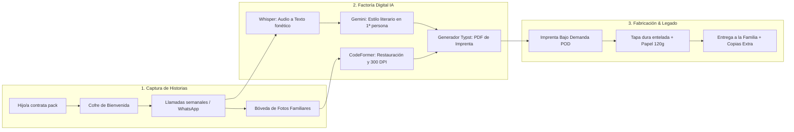

# Plano Técnico y Arquitectura de Negocio: Memorias Vivas Studio (`plan.md`)

## 1. Arquitectura del Flujo Operativo y de Cliente
El sistema opera bajo un modelo de 4 capas:
1. **Capa de Captura Humana (Entrevistas)**: Audios recibidos vía WhatsApp / Teléfono y fotos escaneadas por los hijos.
2. **Capa de Refinamiento y Agentes IA**: Transcripción fonética (Whisper) $\rightarrow$ Estructuración y estilo literario (Gemini) $\rightarrow$ Restauración facial y reescalado 4K de fotos (CodeFormer/GFPGAN).
3. **Capa Editorial y Compilación**: Generador dinámico en Typst que ensambla el texto por capítulos, fotos tratadas y QRs generados a un archivo PDF/X-1a para imprenta.
4. **Capa de Fabricación y Entrega**: Impresión digital bajo demanda (POD: Podiprint / Lulu / Imprenta local de encuadernación artesanal), empaquetado en cofre de lujo y entrega por mensajería privada. Detalle completo en [`operaciones/directorio_proveedores_reales.md`](operaciones/directorio_proveedores_reales.md).

## 2. Diagrama de Arquitectura Interactivo (Archify)
El diagrama interactivo standalone generado con la skill `archify` se encuentra en:
* **Archivo HTML**: [`docs/architecture.html`](docs/architecture.html)
* *Comando de apertura*: `Start-Process "docs\architecture.html"`

### Esquema Rápido en Mermaid:

## 3. Modelo de Datos y Estructura Editorial del Libro
Cada libro se estructura en un estándar editorial de alta gama:
* **Formato**: 170 x 240 mm (formato novela estándar de lujo).
* **Cubierta**: Tapa dura forrada en tela editorial con grabado stamping oro/plata.
* **Tripa**: 120–160 páginas en papel ahuesado Munken Print White 120g/m² (tacto cálido, no cansa la vista).
* **Encartes Fotográficos**: Cuadernillo central en papel estucado semimate de 150g para fotos restauradas a todo color y sepia.
* **Códigos QR de Voz**: Micro-QRs al inicio de cada capítulo que enlazan a la pista de audio limpiada del protagonista alojada en un storage privado.

## 4. Estrategia de Adquisición de Clientes (GTM)
1. **Canal Directo Relacional**: Círculo cero y recomendaciones boca a oreja en entornos profesionales (abogados, consultores, médicos de 40–50 años con padres ancianos).
2. **Asociaciones Estratégicas B2B2C**:
   * Acuerdos con residencias de mayores premium y centros de día.
   * Acuerdos con notarías y despachos de herencias y sucesiones (servicios de legado inmaterial).
3. **Campañas Estacionales**:
   * Black Friday / Navidad (*"El regalo que de verdad les emocionará"*).
   * Día de la Madre / Día del Padre / Campaña de Jubilación.

## 5. Matriz de Riesgos y Mitigaciones
| Riesgo | Impacto | Mitigación |
| :--- | :--- | :--- |
| El mayor se cansa o no quiere hablar | Medio | Sesiones cortas de 15-20 minutos, tono conversacional cariñoso, ayuda de los nietos. |
| Fotos familiares muy dañadas o rotas | Bajo | Restauración algorítmica con CodeFormer y retoque manual asistido. |
| Retrasos en imprenta en fechas clave | Medio | Plazos garantizados de 8 semanas; el regalo entregable inicial es el Cofre de Bienvenida. |
| Sensibilidad sobre secretos familiares | Alto | Los hijos revisan el borrador final antes de mandar a imprenta. |

## 6. Motor de Tráfico y Embudo de Conversión (Extremo a Extremo)
* **Canal Orgánico**: Vídeos virales de reacción (*The Unboxing Reveal*) y demostración de audio QR (*The Voice QR Reveal*) programados mediante `Postiz` (`:4200`) en TikTok, Instagram Reels y YouTube Shorts. Detalle en [`marketing/guiones_videos_virales.md`](marketing/guiones_videos_virales.md).
* **Canal Paid (Meta Ads)**: Campañas dirigidas a hijos/as de 38 a 54 años ("Laura"). CAC estimado: 60 € - 110 € con ROAS objetivo de 7x a 10x. Detalle en [`marketing/estrategia_viral_gtm.md`](marketing/estrategia_viral_gtm.md).
* **Conversión**: Landing page mobile-first + Pasarela de pago en Stripe con **Klarna (3 cuotas sin intereses)** + Webhook a `n8n` (`:5678`) para activar el onboarding y el despacho del Cofre. Detalle en [`marketing/embudo_ventas_landing.md`](marketing/embudo_ventas_landing.md).
